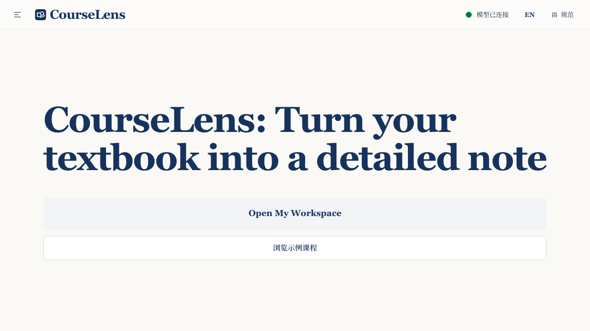
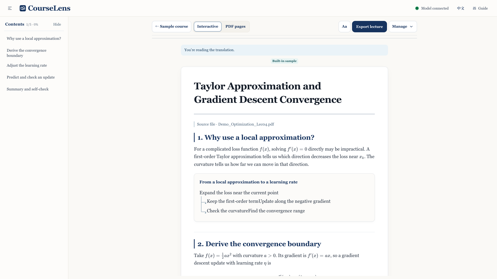
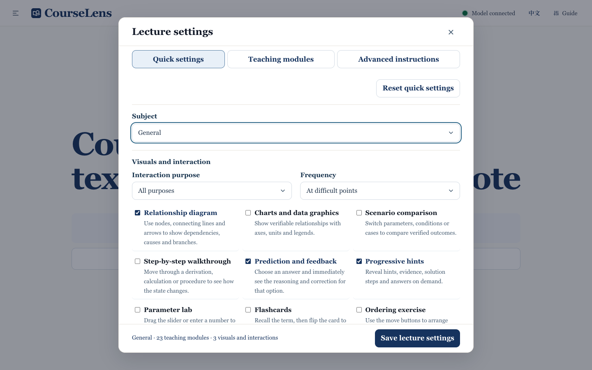
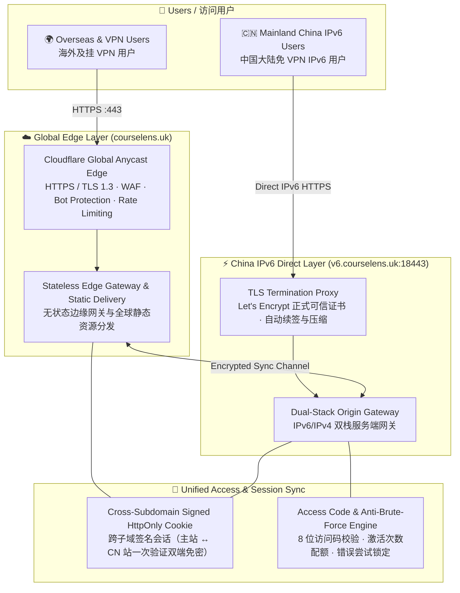
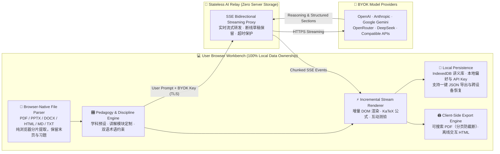

# CourseLens Studio

**Turn your textbook & slides into structured, interactive, bilingual university-grade study notes.**

[English](#-english) | [简体中文](#-简体中文)

---

  

## 🌟 English

**CourseLens Studio** is a privacy-first, local-first AI study workbench that transforms dense university slides and textbooks (`PDF`, `PPTX`, `DOCX`, `HTML`, `Markdown`, `TXT`) into deep, interactive, publication-grade lecture notes — complete with KaTeX math, interactive diagrams, inline self-check quizzes, bilingual EN/ZH reading, and searchable PDF / standalone HTML exports.

### 🌐 Live Access

- **Global / Overseas Site**: **[https://courselens.uk](https://courselens.uk)** (Powered by Cloudflare Workers Edge Network)
- **Mainland China Direct IPv6 Entry (No VPN required)**: **[https://v6.courselens.uk:18443](https://v6.courselens.uk:18443)**
- **Public Examples**: Click **View Provided Example** / **浏览示例课程** directly on the homepage to explore built-in sample lectures across mathematics, optimization, computer science, and more — no login required for samples.

> **Workspace Access**: Personal workspaces (`Open My Workspace`) use an 8-digit invitation/access code. Once verified on a device/browser, both `courselens.uk` and `v6.courselens.uk:18443` stay unlocked seamlessly via cross-subdomain signed session cookies.

---

### ✨ Key Features

- **📚 Multi-Format Courseware Ingestion**
  - Extracts structured text accurately page-by-page from `PDF`, `PPTX`, `DOCX`, `HTML`, `Markdown`, and `TXT` entirely inside the browser.
  - Long documents are chunked cleanly in order so final pages and exercises are never truncated.
- **✍️ Deep Structured Lecture Synthesis & Resumable Streaming**
  - Real-time prefix DOM diffing renders streaming sections, KaTeX equations, code blocks, callouts, and interactive practice modules smoothly without flickering.
  - Supports **pause/resume drafts** on network drops and **drag-to-select inline paragraph rewriting**.
- **🎛️ Customizable Pedagogy & Interactive Visuals**
  - Tailor teaching depth, discipline presets (Mathematics, CS, Physics, Economics, etc.), derivation rigor, intuition-first blocks, and interactive widgets before generating.
- **🌍 Instant Bilingual (ZH ↔ EN) Mode & Terminological Consistency**
  - Translate full lectures while strictly preserving LaTeX formulas, numbers, symbols, code blocks, and discipline terminology.
- **📤 Searchable PDF & Offline Interactive HTML Export**
  - Export full lectures, selected chapters, or custom page ranges to **searchable PDF** (with embedded CJK + math typography and zero orphaned headings/sliced equations) or a **single self-contained offline HTML file**.
- **🔐 Privacy-First BYOK & Local-First Workspace**
  - **Bring Your Own Key (BYOK)**: Connect OpenAI, Anthropic, Google Gemini, OpenRouter, DeepSeek, or compatible providers. API keys and lecture libraries stay in your own browser (`IndexedDB` + `localStorage`) — your personal notes are never stored on any third-party cloud database.
  - One-click **JSON Workspace Backup & Restore** (merge or replace) lets you migrate all folders, notes, and learning progress across browsers or devices anytime.

  

  

---

### 🏗️ Architecture Overview

CourseLens follows a **Local-First + Stateless Edge Gateway + Dual-Region Access** architecture: your slides, notes, and API keys stay inside your own browser, while overseas and mainland China IPv6 users share unified HTTPS access and seamless single-unlock sessions.

#### 1. Dual-Region Access & Security Architecture

#### 2. Local-First Processing & Stateless AI Streaming Pipeline

- **Zero Cloud Retention of Notes**: Lecture libraries, uploaded course materials, reading progress, and user API keys live exclusively in the browser (`IndexedDB` + `localStorage`). The gateway acts purely as a stateless streaming relay.
- **Dual-Region Seamless Experience**: Global traffic routes through Cloudflare's edge network (`courselens.uk`), while mainland China users connect directly via Let's Encrypt HTTPS over IPv6 (`v6.courselens.uk:18443`). Signed `Domain=.courselens.uk` `HttpOnly` session cookies keep both endpoints synchronized without re-entering codes.
- **Defense in Depth**: Strict Origin checks, WAF + IP-based rate limiting, brute-force lockout protection, CSP & security headers, and isolated access-control verification.

---

## 📖 简体中文

**CourseLens Studio** 是一个以隐私和本地存储为核心的 AI 深度学习工作台，能够将高校课件与教材（支持 `PDF`、`PPTX`、`DOCX`、`HTML`、`Markdown`、`TXT`）自动转化为结构严谨、排版精致、支持交互式练习与双语对照的高质量讲义。

### 🌐 在线访问入口

- **国际主站（海外或 VPN 环境）**：**[https://courselens.uk](https://courselens.uk)**（Cloudflare Workers 全球边缘部署）
- **中国大陆 IPv6 直连站（免 VPN，手机流量 / 校园网 IPv6 直连）**：**[https://v6.courselens.uk:18443](https://v6.courselens.uk:18443)**
- **公开示例预览**：打开首页点击 **「浏览示例课程」 / `View Provided Example`**，即可免密体验多学科内置交互式示范讲义。

> **工作区解锁说明**：进入个人工作区（`Open My Workspace`）或上传生成讲义需输入 **8 位数字访问密码**。同一台设备在同一个浏览器完成一次验证后，主站（`courselens.uk`）与 CN 站（`v6.courselens.uk:18443`）会自动共享登录态，无需重复验证。

---

### ✨ 核心亮点

- **📄 纯浏览器端多格式课件解析**：本地直接提取 `PDF`、`PPTX`、`DOCX`、`HTML`、`Markdown`、`TXT` 文字内容，长文档分片有序处理，不遗漏末页与习题。
- **⚡ 流式生成与断点续写**：支持实时渲染 KaTeX 数学公式、代码块、思维过程与互动练习题；生成中断可保留草稿续写，阅读时支持**框选段落 AI 定向重写**。
- **🎛️ 可定制教学规范与学科模板**：按学科自由勾选讲解模块（直觉引入、严格推导、例题精讲、易错辨析等）与交互图表类型。
- **🌐 一键中英双语切换与翻译**：讲义界面与内容支持中英无缝切换，翻译过程严格校对公式、符号、数值与专业术语一致性。
- **🖨️ 高质量可搜索 PDF 与离线 HTML 导出**：支持按整篇、勾选章节或指定页码导出排版精良的**可搜索 PDF**，或导出为**单文件离线交互式 HTML**。
- **🔒 BYOK 自备密钥与本地工作区隐私保护**：
  - 支持接入 OpenAI、Anthropic、Gemini、OpenRouter、DeepSeek 等模型；API Key 与讲义数据全部保存在用户自己的浏览器中，不在云端留存用户私人讲义。
  - 内置**工作区 JSON 一键备份与恢复**（支持合并或替换），方便跨设备与跨浏览器迁移全部讲义和学习进度。

---

### 🏗️ 系统架构详解（零云端留存 · 双站协同）

详细交互架构图见上方 [Architecture Overview](#-architecture-overview)，核心设计分层如下：

1. **双路由接入层**：海外与 VPN 用户通过 Cloudflare 全球边缘节点访问 `https://courselens.uk`；中国大陆用户无需 VPN，直接通过 IPv6 TLS（Let's Encrypt 正式证书）访问 `https://v6.courselens.uk:18443`，兼顾全球加速与国内直连可达性。
2. **跨站免密鉴权层**：验证 8 位数字访问密码后下发跨子域签名 `HttpOnly` 会话凭证（`.courselens.uk`），同一设备在任一入口解锁后，切换到另一站点自动免密通行；配合防暴力破解锁定与访问码多端激活次数管理，保障站点访问安全。
3. **纯浏览器解析与持久化层**：课件文本解析（`PDF` / `PPTX` / `DOCX` / `HTML` / `Markdown` / `TXT`）、可搜索 PDF 排版分页、离线交互 HTML 打包及讲义工作区存储均在用户本地浏览器完成，服务端不存储任何用户私人课件与笔记。
4. **无状态模型流式转发层（BYOK）**：网关仅按会话实时转发用户自带密钥（OpenAI / Anthropic / Gemini / OpenRouter / DeepSeek 等）的模型流式响应，支持增量 DOM 无闪烁渲染、思考过程展示、断线草稿续写与框选段落定向重写。

If you find CourseLens helpful, please consider giving this repository a **⭐ Star**!

如果这个项目对你的学习或教学有帮助，欢迎点亮右上角的 **⭐ Star** 支持一下！

